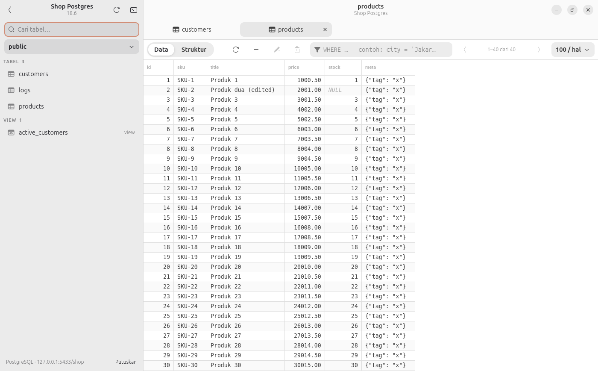
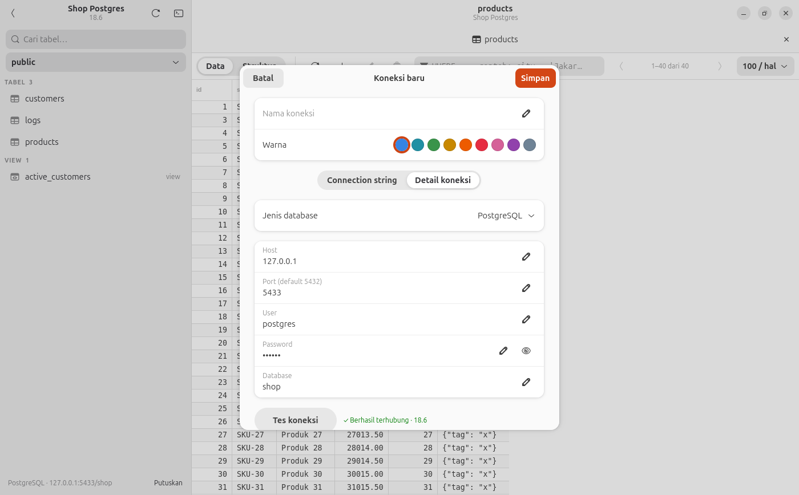
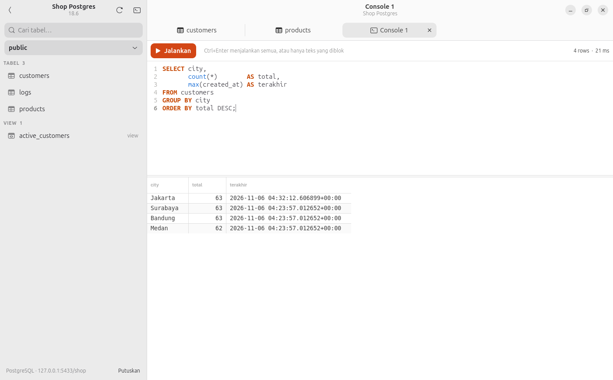

# Databesty

Client database desktop yang simpel untuk GNOME. Buka koneksi PostgreSQL, MySQL/MariaDB atau SQLite, lihat tabel, lalu tambah, edit dan hapus data tanpa nulis SQL. Kalau perlu, ada SQL console juga.



## Fitur

- **Banyak koneksi** tersimpan sekaligus, masing-masing dengan warna sendiri.
- **Dua cara isi koneksi** lewat tab:
  - *Connection string*: tempel URL dari `.env` (`postgres://…`, `mysql://…`, `sqlite:///…`). Baris `DATABASE_URL=…` utuh juga diterima.
  - *Detail koneksi*: isi host, port, user, password, database satu per satu (atau pilih file untuk SQLite).
  
  Pindah tab otomatis membawa isian ke tab sebelahnya. Ada tombol **Tes koneksi**.
- **Daftar tabel & view** per schema (Postgres) / database (MySQL), dengan pencarian.
- **Lihat data** per halaman (50–1000 baris), klik header kolom untuk urutkan, filter pakai `WHERE` bebas.
- **Tambah / edit / hapus baris** lewat form. Kolom kosong saat tambah = pakai default database (auto increment, `now()`, dll). Tombol `NULL` per kolom.
- Tabel tanpa primary key tetap bisa diedit (pakai `ctid` di Postgres, `rowid` di SQLite).
- **Tab Struktur**: kolom, tipe, nullable, default, primary key.
- **SQL console** dengan syntax highlight. `Ctrl+Enter` menjalankan semua atau hanya teks yang diblok.
- Ikut tema terang/gelap GNOME.

| Koneksi | SQL console |
|---|---|
|  |  |

## Install

Butuh GNOME 48+ / libadwaita 1.7+ (Ubuntu 25.04+, Fedora 42+, Arch).

```bash
git clone https://github.com/yandyrohman/databesty.git
cd databesty
./install.sh
```

`install.sh` memasang dependensi sistem (lewat `apt`, `dnf` atau `pacman`, butuh sudo), lalu menginstall aplikasi untuk user saat ini di `~/.local`. Setelah itu buka **Databesty** dari menu aplikasi.

Update: `git pull && ./install.sh`. Hapus: `./uninstall.sh`.

Dependensi manual (Ubuntu/Debian):

```bash
sudo apt install python3-gi gir1.2-gtk-4.0 gir1.2-adw-1 gir1.2-gtksource-5 python3-psycopg2 python3-pymysql
```

Jalankan langsung dari folder repo tanpa install: `./bin/databesty`.

## Pintasan keyboard

| Tombol | Aksi |
|---|---|
| `Ctrl+N` | Koneksi baru |
| `Ctrl+T` | SQL console baru |
| `Ctrl+P` | Cari tabel |
| `Ctrl+W` | Tutup tab |
| `F5` | Muat ulang tabel |
| `Enter` / klik dua kali | Edit baris |
| `Delete` | Hapus baris terpilih |
| `Ctrl+C` | Salin baris terpilih (TSV, bisa ditempel ke spreadsheet) |
| `Ctrl+Enter` | Jalankan query di console |

## Catatan

- Koneksi disimpan di `~/.config/databesty/connections.json` dengan izin `0600` (hanya user kamu yang bisa baca). Password ikut tersimpan di file ini.
- Perubahan dari form dan console langsung di-commit.
- Console Postgres hanya menampilkan hasil statement terakhir kalau menjalankan beberapa query sekaligus.

## Lisensi

MIT
